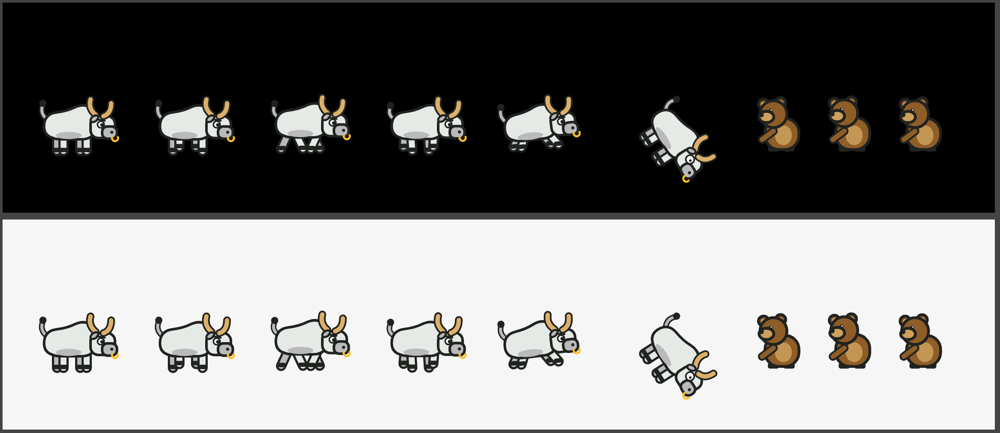

# The classic bull and bear

These are the game's characters as they were until 16 October 2026, kept so they can come back at any time. On that day, the bull and the bear the user locked in the Candle Runner Figma file replaced them (`docs/decisions.md`, "the bull and the bear from Figma").

## What is here

| file | what |
|---|---|
| `art.ts` | `src/game/art.ts` as it was: `drawBull()` and `drawBear()`, drawn with canvas strokes and fills, no images |
| `tokens.css` | the character tokens from `src/game/tokens.css`, and the palette entries `art.ts` reads |
| `classic-characters.png` | every pose rendered at 3x: the bull idle, running at three phases, jumping and crashing, and the bear breathing, in Dark (top) and Light (bottom) |

This folder is not compiled or linted (`tsconfig.json` and `eslint.config.mjs` skip it). It is a snapshot: it keeps compiling only against the engine it came from.

## How to bring them back

1. Copy `art.ts` over `src/game/art.ts`.
2. Put the tokens from `tokens.css` back into `src/game/tokens.css`. Put the eight palette entries back into `Palette` and `readPalette()` in `src/game/palette.ts`.
3. Check the calls in `drawScene()` in `src/game/engine.ts` against the signatures:
   - `drawBull(ctx, P, x, y, pose, anim, tilt, alpha)`, with `pose` one of `"run" | "jump" | "crash" | "idle"`;
   - `drawBear(ctx, P, x, y, t, alpha, still)`.
4. Run `npm run verify`, then look at the game in both modes.

The git history has them too: commit `8410c43` holds the classic art before the harmonisation of 16 October.
