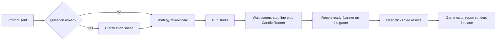

# Candle Runner

**Owner:** Product. **Date:**  built and verified on 13 October 2026; section 7 (results handoff) is a change to that build. Game file: `candle-runner-loading.html`. Review copy: [Candle Runner review build](https://claude.ai/artifact/QftgubanF9Vop7GH8WQioh)

| Version | Date | Author | Comments |
| --- | --- | --- | --- |
| 1 | 13 October 2026 | Product | First issue, written against the prototype (sourced from the version 088bb48 file). Rewritten against the shipped build. Problem statement measured from analytics. Difficulty pacing of 13 October. Results handoff changed from auto close to notify and click. |
|  |  |  |  |

Candle Runner is the game shown in the backtest chat while a run computes. A bull runs along a candlestick chart and the user jumps the red candles until the report lands. It has four parts:

1. **The wait screen frame.** Where the game sits, its size, fonts and colours.
2. **The game.** Rules, physics, candles, terrain, hazards, fairness and pacing.
3. **The results handoff.** How the user learns the report is ready and opens it.
4. **Measurement.** Events, metrics, edge cases and the verification suite.

The game never decides when a result exists and never closes itself. The host page tells it, and the user opens the report.



# 1. Problem statement

Every figure below is computed from the analytics project for 30 days to 15 October 2026, team accounts included, counted as events, unless the line says otherwise.

1. **The path from prompt to report has three waits.** The clarification sheet waits for an answer. The review card waits for the user to press Run. The run itself waits for the engine.
2. **Clarification is asked often and answered well.** 69% of prompts get a clarifying question (1,275 of 1,845 in the funnel). 96% of those get answered (1,221 of 1,275) (computed).
3. **The drop starts after the answer.** 63% of answered clarifications start a run within the hour (769 of 1,221). The average gap from answer to run start is 6 minutes 19 seconds. That gap is the review card (computed).
4. **An unanswered question kills the run.** The sheet expires after 15 minutes and the run is lost (sourced from the Query Flow page). 200 runs failed this way in the 30 days to 28 September 2026 (sourced).
5. **The run is the longest wait.** A backtest takes 5 minutes 8 seconds on average from run start to result (968 completions within the hour). 59% of backtest runs reach a result within an hour (968 of 1,651). 3,575 backtest runs started in 30 days, 1,499 completed, 177 failed (computed).
6. **The screen gives nothing to do during the run.** It shows one grey line, "Preparing your equity strategy", a spinner, and an empty column 870 pixels tall below it (observed, 13 October 2026, screenshot at 2,000 by 1,299 pixels).
7. **Four in ten results land on an empty seat.** The next event after 1,499 completions was leaving or nothing for 601 (40%): side navigation 284, another surface 141, report closed 88, a chat opened 48, no further event 40. The next event was reading the report for 800 (53%): view changed 436, trade log opened 155, strategy save 71, share 49, export 47, settings 42. The remaining 98 (7%) were other events (computed).
8. **Readers come back late.** 64% of completed backtests get a report view change within the hour (615 of 968). The first view change comes 4 minutes 27 seconds after the result lands on average. Assessment: the user had left the screen and returned (computed).
9. **The spinner says nothing about progress.** The run has a 60 minute ceiling (sourced from Product Requirements, section 8). The user cannot tell a 30 second run from a 10 minute one.

**Boundary.** Candle Runner covers wait 3, the run. It does not change the clarification sheet or the review card. Items 2 to 4 are stated so the reader sees where the drop starts and what this feature leaves alone.

# 2. User outcome and business outcome

1. **User outcome.** The wait has something to do that belongs to a trading product. The report is one click away the moment it lands, mid game or not.
2. **User outcome when the run is long.** The timer shows how long the wait has been, and the game stays playable at any length.
3. **Business outcome: results get read.** Fewer completions are followed by leaving. More reports are read within a minute of landing.
4. **Business outcome: a reason to talk.** A score the user can copy and paste into a group.

# 3. Principles and non goals

**Principles**

1. **Never delay or hide the result.** The banner renders within 100 milliseconds of the host message. The report renders the moment the user clicks.
2. **The user closes the game, not the clock.** No automatic close on result arrival (ruling, 15 October 2026).
3. **One input.** Tap, click, Space or Up arrow. Nothing to read, nothing to learn.
4. **The chart is the level.** Every object on screen is a candlestick chart object: candle, wick, gap, doji, bull, bear.
5. **Every death is the player's fault.** Fairness is enforced in the spawner from the jump physics, not tuned by hand.
6. **Minimal animation.** Flat 2D canvas, no particles beyond a "+1" puff, no sound.
7. **Same frame as the product.** Inter, the loading screen greys and greens, the chat column width.
8. **Zero dependencies.** One file. The only network request is the Inter font.

**Non goals**

1. **Real market data.** Candles are generated.
2. **Sound.**
3. **Accounts, server storage, leaderboards.** The high score lives on the device.
4. **A standalone game page.**
5. **Screening runs.** This release covers backtest runs only. Screens finish in a median of 46 seconds for real users (sourced from Product Requirements, section 8) and are a candidate after the first 4 weeks.
6. **Mobile layouts.** The game must not break on a phone, but the product release is desktop web.

# 4. Main user journey

1. **Prompt sent.** The user sends a backtest prompt from Chat home.
2. **Clarification.** If a detail cannot be defaulted, the sheet asks. The user answers.
3. **Review card.** The user checks the strategy and presses Run.
4. **Run starts.** Step 2 appears: grey spinner, "Preparing your equity strategy". The game frame appears directly below it within 1 second of run start.
5. **Intro.** Candles ink in from left to right over 0.9 seconds. The bull drops onto the chart. The witty line fades in. The timer starts at 0:00 (design rule).
6. **First hazard.** About 5 seconds in, one red candle approaches with a gold "↑ jump" flag over it. A hint reads "Tap or press space to jump" for the first 6 seconds of the first run.
7. **Play.** The user jumps hazards. Score climbs with distance. Speed rises over 50 seconds (design rule).
8. **Death and restart.** The bull tips over. The card shows the score and a line naming the cause. The game restarts after 2.6 seconds, or at once on a tap (design rule).
9. **Report lands.** A banner appears at the top of the game: "Your backtest is ready", with a "See results" button. Step 2 flips to a green check, "Backtest ready". The timer stops. The game keeps running.
10. **User opens the report.** The user clicks the banner button, or "See results" on the next game over card. The game fades out in 0.47 seconds. The report renders in the same place (design rule).

**Journeys that must all work**

1. **First time user who plays.** Sees the flag, jumps, clears the first red, gets a "+1", plays until the banner appears, clicks it.
2. **User who ignores the game.** Never touches it. The bull dies on the coached red at about 4.7 seconds. The game restarts every 2.6 seconds until the banner appears. The screen is never still (measured).
3. **Competitive user.** Dies, taps to restart at once, beats the high score, sees the rupee note pulse, presses C, pastes the score line into a group.
4. **Keyboard user.** Tabs to the canvas, presses Space to jump. Or activates "Skip the game" to remove it.
5. **Long run.** The timer chip turns amber at 30 seconds with a dry suffix and changes the suffix again at 90 seconds. Speed caps at 7.0 so the game stays playable for the full 60 minute ceiling (design rule).
6. **User leaves the conversation.** The host posts `cr:dismiss`. The game fades out and is removed. The high score survives in the device.

# 5. The wait screen frame

1. **Position.** Directly below the step 2 line, inside the chat column. The column is 1,005 pixels wide and centred (observed, 13 October 2026).
2. **Width.** Full column width. The canvas stretches with the column.
3. **Height.** Canvas 380 pixels. Top bar 24 pixels. Score strip 32 pixels. Frame height 439 pixels including borders and margins (measured in the review frame).
4. **Narrow widths.** Canvas 300 pixels tall below 900 pixels wide, 230 below 600. The bull moves from x 142 to x 92 below 520 pixels wide so more chart is visible ahead (design rule).
5. **Top bar.** Left: a witty line in 14 pixel grey (#a3a3a3), signed "tl/." in green weight 600. Right: a timer chip, 13 pixel, rounded, 1 pixel border, clock icon, "m:ss" in tabular figures.
6. **Score strip.** Left: "Hi 00000". Right: a rupee note icon tilted 4 degrees, then "Score 00000". Labels 12 pixel uppercase grey (#6b7a73), figures 14 pixel white weight 600.
7. **Panel.** 1 pixel border at 8% white, 12 pixel radius, fill at 1.6% white. Brand mark "tl/." bottom right of the canvas at 13 pixel (design rule).
8. **Font.** Inter 400, 500 and 600 from Google Fonts, with the system font stack as fallback. If third party fonts are blocked on the product, point the link at the product's own Inter file.
9. **Background.** Transparent inside a frame, so the page gradient shows through. Standalone, the page ground is #0a120e.

**Colour tokens** (read from the loading screen on 13 October 2026; the host can override any of them)

| Token | Value | Used for |
| --- | --- | --- |
| `--cr-bg` | #0a120e | page ground when standalone |
| `--cr-fg` | #ffffff | score figures, game over score |
| `--cr-fg-2` | #d4d4d4 | "GAME OVER" label |
| `--cr-fg-3` | #a3a3a3 | witty line, timer, hints |
| `--cr-fg-4` | #6b7a73 | score strip labels |
| `--cr-grid` | #8aa89a | gridlines at 10%, price labels at 42% (design rule) |
| `--cr-green` | #4fb37c | green candle body, signature, restart pill |
| `--cr-green-edge` | #7ad3a0 | green candle outline and wick |
| `--cr-green-deep` | #37724e | brand green |
| `--cr-mint` | #a9e5c3 | "+1" puffs, restart pill text |
| `--cr-red` | #dc5550 | red candle body |
| `--cr-red-edge` | #f2817b | red candle outline and wick |
| `--cr-neutral` | #5f6d67 | doji wall body |
| `--cr-neutral-edge` | #8e9c96 | doji wall outline |
| `--cr-gold` | #e6c46a | jump flag, "NEW BEST" chip, bull's nose ring |
| `--cr-amber` | #d9a441 | timer chip from 30 seconds |
| `--cr-bull` | #efe7d6 | bull body |
| `--cr-bear` | #8a5a3b | bear body |

# 6. The game

## Rules

1. **One input.** Tap or click anywhere on the canvas, press Space, or press Up arrow. Each press is one jump. Holding does nothing. Keys are ignored while focus is in a text field, so the prompt box is never affected.
2. **The bull runs right.** The chart scrolls left under it. The bull's centre stays at x 142 (x 92 on narrow screens).
3. **Wicks never hurt. Bodies kill.** Touching the body of a red candle or a doji wall ends the run. Touching the bear ends the run. Running into a gap with no candle below ends the run.
4. **Score is distance.** Score equals pixels travelled divided by 12, shown as 5 digits, "00247". A "+1" puff floats up each time a hazard passes behind the bull.
5. **High score.** Saved on the device under the key `cr-hi`, shown as "Hi". The rupee note pulses once when a run passes the previous best during play.
6. **First hazard is coached.** The first hazard of every run is a single red candle, 20 slots in (about 5 seconds at start speed), with a gold "↑ jump" flag bobbing above it.
7. **Game over card.** "GAME OVER", the score in 40 pixel white, "NEW BEST" in a gold chip only when the run beat a previous best above zero, one line naming the cause, a pill "Again · 2.6s" counting down, and the line "tap to restart now · press C to copy your score" (design rule).
8. **Restart.** Automatic after 2.6 seconds. Immediate on tap, click, Space or Up arrow once 250 milliseconds have passed since the death (design rule).
9. **Copy.** C on the game over card copies "I dodged 14 candles and scored 00247 waiting for my backtest. Candle Runner on Tradl." with the run's own counts.
10. **Speed.** Starts at 2.8 pixels per frame, rises 0.0014 per frame, caps at 7.0. The cap is reached about 50 seconds into a run (design rule).

## Physics and motion

All constants live in one block at the top of the script. The fairness rules under Fairness rules are derived from them, so feel and fairness cannot drift apart.

```jsx
CANDLE_W = 22      // candle body width in pixels
SLOT = 38          // distance between candle centres in pixels
PPU = 21           // pixels per price unit
JUMP_V = -10.2     // jump velocity, pixels per frame, upward
GRAV = 0.46        // gravity, pixels per frame per frame
SPEED0 = 2.8       // start speed, pixels per frame
SPEED_MAX = 7.0    // top speed
ACCEL = 0.0014     // speed gain per frame
BUFFER_MS = 150    // early press honoured on landing
COYOTE_MS = 100    // late press honoured after leaving an edge
STEP_MAX_PX = 36   // tallest step the bull walks up
BOX_L = -16, BOX_R = 24, BOX_H = 30   // bull hit box around centre x and feet y
RESTART_MS = 2600
MAX_RISE_U = 1.55
WALL_MIN_SPEED = 3.0, DOUBLE_MIN_SPEED = 3.6, TRIPLE_MIN_SPEED = 4.6
FIRST_HAZARD_SLOTS = 20
```

1. **Time unit.** One frame is 1/60 second. Every motion is scaled by the real frame time, so the game runs at the same speed on a 60, 90 or 120 hertz screen. A frame longer than 32 milliseconds is treated as 32, so a hidden tab never produces a leap.
2. **Scroll.** Every candle moves left by speed × frame time each frame. Distance and score accumulate from the same number.
3. **Jump.** A press sets vertical velocity to 10.2 pixels per frame upward. Gravity adds 0.46 downward each frame (design rule).
4. **Apex.** 10.2 squared divided by (2 × 0.46) equals 113 pixels. Computed from the constants.
5. **Air time.** 2 × 10.2 divided by 0.46 equals 44.3 frames, 0.74 seconds. Computed.
6. **Jump range.** 44.3 frames × speed: 124 pixels at speed 2.8, 310 pixels at speed 7.0, so 3.3 to 8.2 slots. Computed.
7. **Input buffer.** A press up to 150 milliseconds before landing fires the jump at the moment of landing.
8. **Coyote time.** A press up to 100 milliseconds after running off a candle edge still jumps.
9. **Landing.** While falling, the bull lands if its feet cross a candle top within the frame, or if the top is at most 36 pixels above the feet. The feet snap to the top.
10. **Stepping up.** Walking onto a taller candle climbs it at once when the rise is at most 36 pixels (1.7 units). The rising cap of 1.55 units keeps every green step inside this (design rule).
11. **Stepping down.** Walking onto a lower candle starts a short fall with coyote time. The bull lands on it.
12. **Falling out.** When the bull's head is 24 pixels below the canvas bottom, the run ends: cause "gap" if the last candle under it had a gap after it, else "fall".
13. **Hit box.** 16 pixels left and 24 right of the bull's centre, 30 pixels above the feet. Red and wall bodies count 2 pixels narrower on each side and 1 pixel lower at the top, so a grazed edge is not a death. The bear counts 13 pixels either side of its centre and 30 tall.
14. **Camera.** The chart scrolls vertically so the bull's feet sit at 60% of the canvas height. It eases 8% of the remaining distance per frame while the bull is on the ground and holds still during a jump (design rule).
15. **Scale.** 21 pixels per price unit. Candle body 22 pixels wide, 38 pixels between centres, so 16 pixels of air between bodies.
16. **Bull poses.** Run: four legs alternate, body bobs 1.5 pixels. Jump: legs tucked, nose up 0.12 radians. Crash: tips forward over 260 milliseconds, eye wide. Idle: used during the intro drop. Above speed 4.5 the bull leans forward 0.08 radians (design rule).
17. **Shadow.** An ellipse under the bull on the candle top. It shrinks to 65% width and fades to 30% at the apex, so height reads at a glance (design rule).
18. **Intro.** Candles ink in left to right over 0.9 seconds, each 0.045 seconds after the last. The bull fades in and drops 8 pixels onto the chart at 45% of the intro. Play starts when the intro ends. With reduced motion the intro is skipped (design rule).

## Candles and terrain

1. **Candle anatomy.** Each candle has open, close, high and low in price units. The body runs from open to close. Two pixel wicks run to high and low. A green candle closes above its open.
2. **Walkable surface.** The bull stands on the top of a green body. Wicks are drawn through and never touched.
3. **Three moods.** Up 34%, down 28%, chop 38% of rolls. A repeat of the current mood is re-rolled 70% of the time. A mood lasts 3 to 6 candles, chop 4 to 8 (design rule).
4. **Up.** Body 0.8 to 1.5 units. Open 0 to 0.2 units below the last close. Close capped at the last close plus 1.55 units (the rising cap) (design rule).
5. **Down.** Open 1.0 to 1.7 units below the last close. Body 0.3 to 0.7 units, green. A staircase down of green candles, never a run of reds (design rule).
6. **Chop.** Body 0.3 to 0.8 units. Close within 0.45 units of the mood's anchor price (design rule).
7. **Wicks.** Upper 0.1 to 0.9 units, lower 0.2 to 0.9 units (design rule).
8. **What is inked.** Candles within 6 slots ahead of the bull are drawn solid. Candles further out are pencilled: outline and wick at 26% opacity. A candle inks in over the 2 slots before the 6 slot line. Decision of 13 October 2026, replacing the gradient veil of version 1 (design rule).
9. **Gridlines.** Dashed lines every 4 price units at 10% opacity, price labels at the right in 11 pixel. The chart floats with the camera; no fixed axis (design rule).
10. **Start.** Price 100, chop mood, 3 candles, and the chart filled 3 slots past the right edge before the first frame.

## Hazards

| Hazard | Look | Geometry | Kills by | When it can spawn |
| --- | --- | --- | --- | --- |
| Red candle | red body that opens above the feet and closes below | body top 1.0 to 1.6 units above the feet, close 0.2 to 0.5 below | body contact | always; the first hazard of every run (design rule) |
| Red streak | 2 or 3 reds in a row, each 0.15 units lower | one slot apart | body contact with any | 2 from speed 3.6 (42% of reds), 3 from speed 4.6 (30%) (design rule) |
| Gap | no candle, a dashed bracket at the last candle's top | 36 to 104 pixels wide | falling in | after the first red, only after a plain green candle |
| Doji wall | tall neutral candle with diagonal hatching | 1.8 to 2.4 units tall from the feet | body contact | speed 3.0 or more, never in an up mood (design rule) |
| Bear | brown bear on a green candle, breathing | 26 pixels wide, 30 tall | touching | after the first red |
1. **Red candle.** Opens 1.0 to 1.6 units above the bull's feet and closes 0.2 to 0.5 below them. The body sits in the bull's path and the top is under the 113 pixel apex. Upper wick 0.3 to 0.8 units, harmless (design rule).
2. **Red streak.** Each following red is 0.15 units lower. The streak is one hazard for the runway rule: the safe landing starts after the last red (design rule).
3. **Gap.** Width is random between 36 pixels and the jump range minus 70 pixels, clamped between 56 and 104. The candle after the gap sits at the same price as the one before. A dashed line with end ticks marks the missing floor (design rule).
4. **Doji wall.** Body from 0.1 units below the feet to 1.8 to 2.4 units above. Too tall to walk over, low enough to jump. Neutral grey with white hatching so it never reads as red (design rule).
5. **Bear.** Stands on a green candle at the current price, facing the bull, arm out. It breathes but does not move.
6. **Weights.** Red 0.44. Gap 0.22 when the previous candle is a plain green. Wall 0.14 plus 0.10 × ramp when allowed. Bear 0.18. Ramp equals (speed minus 2.8) divided by 4.2, from 0 to 1 (design rule).
7. **Hazard chance.** Each candle that is eligible (see Fairness rules) becomes a hazard with probability 50% plus 30% × ramp (design rule).
8. **Death lines.** One is picked at random for the cause.

| Cause | Lines |
| --- | --- |
| Red candle | "Stop-loss hit. Ego intact." or "Red candle one, bull nil." |
| Gap | "Gap got you. Mind the gap." or "Fell through the gap. Indices do it too." |
| Fall | "Ran out of chart." or "No candle under you. Happens." |
| Doji wall | "Doji wall. Indecision kills." or "Walked straight into indecision." |
| Bear | "A bear? In this market?" or "The bear was not a drill." |

## Fairness rules

Every rule is enforced when the candle is created, using the jump range from Physics and motion, so nothing unwinnable can appear.

1. **Runway.** After every hazard, the next candles are green and flat at the hazard's base price. Their count is the larger of 3 and (jump range plus 40 pixels) divided by 38, rounded up: 5 candles at start speed, 10 at top speed. Computed.
2. **Idle candles.** After the runway, 0 to 2 plain candles pass before the next hazard roll.
3. **Flat approach.** A hazard spawns only when the last 2 candle tops (3 above speed 4.5) are within 0.35 units of each other and none carries a gap or a bear. Otherwise a flat green candle is placed and the roll repeats on the next slot. Decision of 13 October 2026, added after a test death on a wall placed after a step down (design rule).
4. **Rising cap.** Consecutive green tops rise at most 1.55 units, so the fall side of a jump always meets the staircase (design rule).
5. **Walls stay off slopes.** A wall never spawns during an up mood.
6. **Gaps never chain.** A gap sets a runway like every hazard, so a gap landing never meets another hazard.
7. **Missed gap.** Overshooting the far edge of a gapped candle falls without a collision, so the player sees the fall rather than an instant death.
8. **Coached start.** Walls and bears stay locked until the first red has spawned. The first red carries the flag. With no input the bull dies on it at 4.5 to 4.7 seconds (measured 13 October 2026).
9. **Verified.** A scripted player that jumps from the physics window survived 45 seconds on each of three inputs with zero deaths, 35 jumps per run, speed 6.64 reached, all four hazards met (red 19, bear 8, gap 5, wall 3), 21 streak candles cleared, and a maximum green step of 0.90 units against the 1.55 cap (measured 13 October 2026).

## Difficulty pacing

Set on 13 October 2026 after review feedback that the game was too easy. The knobs and their effect:

| Knob | Value | Effect |
| --- | --- | --- |
| Speed | 2.8 to 7.0 over about 50 seconds | pace of the whole run (design rule) |
| Hazard chance | 50% to 80% per eligible candle | how often a hazard appears (design rule) |
| Runway margin | jump range plus 40 pixels, minimum 3 candles | how soon the next hazard can follow |
| Idle candles | 0 to 2 | gap between runway and next roll |
| Red streaks | 2 from speed 3.6 at 42%, 3 from 4.6 at 30% | long jumps mid run (design rule) |
| Gap width | 36 to 104 pixels, grows with speed | timing precision needed |
| Walls | from speed 3.0, weight 0.14 to 0.24 | taller obstacles earlier (design rule) |

If the next review finds it too hard, raise the runway margin first. If too easy, raise the speed gain or lower the streak thresholds.

## Screen copy

1. **Witty lines**, one shown at a time, rotating every 14 seconds: "Replaying four years of candles. Jump the red ones." "The backtest is running. So is the bull." "Wicks never hurt anyone. Bodies do." "Patience is also a position." "Every red candle you clear is one your strategy did not have to."
2. **Timer suffixes.** From 30 seconds: "· still cheaper than a brokerage call". From 90 seconds: "· thick order book, this one". The chip turns amber from 30 seconds.
3. **Hint.** "Tap or press space to jump" on a mouse device, "Tap to jump" on touch. First run only, first 6 seconds.
4. **Flag.** "↑ jump" over the first red.
5. **Card.** "GAME OVER", "NEW BEST", "Again · 2.6s", "tap to restart now · press C to copy your score" (display only).
6. **Share line.** "I dodged N candles and scored 00247 waiting for my backtest. Candle Runner on Tradl."
7. **Screen reader label.** "Candle Runner. A bull runs along a candlestick chart while your backtest loads. Tap, click, or press space to jump over red candles, gaps, doji walls and bears."
8. **Skip link.** "Skip the game", hidden until focused by keyboard.

# 7. Results handoff

The host decides when a result exists. The user decides when to open it. The game never closes itself. This section replaces the 13 October behaviour, where the host posted `cr:dismiss` on completion and removed the frame after 750 milliseconds.

1. **Trigger.** The moment the report is ready, the host posts `cr:results` to the game frame. The old `cr:dismiss` stays for a forced close, used only when the user leaves the conversation.
2. **Banner.** A bar slides in at the top of the game panel, above the canvas, in 220 milliseconds. Left: a green check and "Your backtest is ready" in 14 pixel white. Right: a filled green button, "See results". Height 40 pixels. The frame grows by 40 pixels and posts its new size.
3. **Step line.** At the same moment the host flips step 2 to a green check with "Backtest ready" and the steps line to "Show steps · 2 steps". Already built in the review copy.
4. **Timer.** The chip stops and reads "ready in m:ss". It never counts past the arrival.
5. **The game continues.** No pause, no fade, no slowdown. Score keeps counting. The bull keeps running. Nothing closes until the user acts.
6. **Game over while a result waits.** The card's first pill becomes "See results", filled green. "Again" becomes a second pill, outlined, to its right. The 2.6 second automatic restart is suspended. A tap on the canvas outside the pills does nothing. Space or Up arrow restarts. Enter opens the results. C still copies (design rule).
7. **Open.** A click on the banner button or on "See results" posts `results-opened` to the host with the score, the high score and the seconds since the banner appeared. The game fades and slides down 10 pixels over 0.47 seconds (0.22 with reduced motion). The host removes the frame 750 milliseconds after the click and renders the report in the same column position (design rule).
8. **Keyboard.** The banner button is in the tab order between the skip link and the canvas. Enter or Space on it opens the results. While the canvas has focus, Enter opens the results once the banner is up.
9. **Screen reader.** The live region announces "Your backtest is ready. Press Enter to see results."
10. **Result during the intro.** The banner appears over the intro. The intro completes and play starts as usual.
11. **Result during a game over card.** The card switches to the two pill layout of item 6 at once.
12. **Result within 1 second of the game appearing.** The banner shows as soon as the game has painted. The game stays until the user clicks.
13. **Result while the tab is hidden.** The banner is rendered on return. The timer shows the arrival time.
14. **Run fails.** The host posts `cr:failed`. The banner is red tinted: "The backtest could not finish", button "See details". Click behaviour as item 7. The game over card leads with "See details".
15. **User leaves the conversation.** The host posts `cr:dismiss`. The game fades out and the frame is removed. No banner.
16. **Second run from the same conversation.** The frame is removed with the old run and mounted fresh with the new one. The high score survives on the device.

**Host integration**

```html
<iframe id="cr-frame" src="/candle-runner-loading.html?embed=1"
        title="Candle Runner" style="border:0;width:100%;height:439px;background:transparent"></iframe>
```

```jsx
// size the frame from the game's own height
window.addEventListener('message', function (e) {
  var m = e.data || {};
  if (m.source !== 'candle-runner') return;
  if (m.event === 'size') frame.style.height = m.data.height + 'px';
  if (m.event === 'results-opened') {
    setTimeout(function () { frame.remove(); renderReport(); }, 750);
  }
});
// when the report is ready, tell the game; do not remove the frame
frame.contentWindow.postMessage('cr:results', '*');
// when the run fails
frame.contentWindow.postMessage('cr:failed', '*');
// only when the user leaves the conversation
frame.contentWindow.postMessage('cr:dismiss', '*');
```

# 8. Non functional requirements

1. **One file.** 48 kilobytes. No images, no libraries. The rupee note is inline vector. All art is drawn on the canvas.
2. **Font.** Inter from Google Fonts is the only network request. Replace with the product's own Inter file if third party fonts are blocked.
3. **Frame cost.** 0.12 milliseconds of script and 0.65 milliseconds of total task per frame; frame time median 8.3 and 95th percentile 9.2 milliseconds, desktop headless (measured 13 October 2026). Budget on a mid range Android phone: 2 milliseconds of script per frame (assumption, not measured).
4. **Errors.** Zero script errors in every verification run. The host never sees an exception from the frame.
5. **Sharpness.** The canvas renders at the device pixel ratio, capped at 2.
6. **Hidden tab.** The loop stops while the tab is hidden and resumes on return. No catch up jump.
7. **Reduced motion.** With the system preference set: no intro, no bob, no bear breathing, exit in 220 milliseconds.
8. **Storage.** The high score uses local storage inside a try block. In private mode the score lives for the session only.
9. **Sandbox.** Works with `sandbox="allow-scripts"`. No cookies, no network beyond the font.
10. **Keys.** Bound inside the frame only. Ignored when focus is in an input, text area, select or editable element.
11. **Accessibility.** Canvas focusable with a descriptive label. Game over and result announced in a live region. Skip link in the tab order. Focus ring on the canvas.
12. **Theming.** Every colour is a token the host can override from its own stylesheet.
13. **Width.** No horizontal scroll at 390 pixels wide (measured).

# 9. Success metrics and guardrails

Window: 4 weeks from launch, team accounts excluded. Baselines are from section 1.

1. **Results read within 60 seconds.** Share of completions followed by a report interaction within 60 seconds. Baseline: first interaction 4 minutes 27 seconds after landing on average (computed). Target: median under 30 seconds (assumption).
2. **Left before reading.** Share of completions whose next event is navigation away or nothing. Baseline 40% (computed, 601 of 1,499). Target 25% (assumption). Stop rule: above 45% for 7 days (assumption).
3. **Played.** Share of game impressions with at least one jump. Target 60% (assumption, from the prototype document).
4. **Copied.** Share of game over cards where C was pressed. Target 2% (assumption).
5. **Guardrail, result delay.** Banner within 100 milliseconds of `cr:results` in the verification suite. Report rendered within 750 milliseconds of the click. Zero tolerance.
6. **Guardrail, errors.** Zero script errors from the frame in production logs. Stop after one per 1,000 impressions.
7. **Guardrail, frame time.** 95th percentile under 16.7 milliseconds on the reference laptop in the suite (computed).

# 10. Events

The game posts events to the host page. The host forwards them to analytics under the names below. Property names in brackets.

| Event | Fires when | Properties | Status |
| --- | --- | --- | --- |
| `game_shown` | the game has painted its first frame | `wait_seconds` so far | new |
| `game_first_jump` | the first jump of the session | `seconds_in` | new |
| `game_over` | a run ends | `score`, `cause`, `hazards`, `seconds`, `run` | new |
| `game_new_best` | a run passes the previous best | `score` | new |
| `game_results_ready` | the banner appears | `wait_seconds`, `runs`, `phase` | new |
| `game_results_opened` | the user clicks See results | `seconds_since_ready`, `score`, `from` banner or card | new |
| `game_score_copied` | C pressed on the card | `score` | new |
| `game_skipped` | Skip the game activated | `seconds_in` | new |
| `backtest_completed` | existing | add `game_shown` true or false | existing, new property |

**Event gaps**

1. **No event marks the report as read today.** `backtest_view_changed` fires only when the user changes a view, so a user who reads the default view counts as absent. Metric 1 needs a `backtest_report_viewed` event on first paint of the report in the viewport.
2. **Run type does not separate equity from options** (sourced from the Query Flow page). Wait time by engine needs that split.

# 11. Edge cases

| Case | When | Then | Owner |
| --- | --- | --- | --- |
| Result mid jump | `cr:results` arrives while the bull is in the air | banner slides in; the jump completes; play continues | front end |
| Result during intro | arrives in the first 0.9 seconds | banner over the intro; play starts as usual | front end (design rule) |
| Result on the card | arrives while the game over card shows | card switches to See results and Again pills; countdown suspended | front end |
| Instant result | arrives before the first paint | banner shows with the first frame; game stays until click | front end |
| Hidden tab | arrives while the tab is hidden | banner on return; timer shows arrival time | front end |
| Run fails | `cr:failed` arrives | red banner, See details; same click path | front end |
| No input | user never touches the game | death at about 4.7 seconds on the coached red; restart every 2.6 seconds | none (measured) |
| Restart spam | tap repeatedly on the card | one restart per tap after 250 milliseconds; state reset each time | none |
| Clipboard denied | C pressed, browser refuses | nothing happens; no error | none |
| No local storage | private mode | high score for the session only | none |
| Narrow column | width under 600 pixels | canvas 230 tall, bull at x 92 | none (design rule) |
| Fonts blocked | Inter does not load | system font stack; layout unchanged | front end |
| User leaves | conversation closed mid run | `cr:dismiss`; game removed; high score kept | front end |
| Second run | new prompt in the same conversation | fresh frame; high score kept | front end |
| Two hazards after one jump | spawner | impossible; every hazard forces a runway | none |

# 12. Verification

The suite `verify.py` runs in a headless browser against the game file and the review frame. It is the regression gate before any change ships.

| Check | Expected | Result 13 October 2026 |
| --- | --- | --- |
| Scripted player, 45 seconds, Space | zero deaths, zero errors | 0 deaths, 35 jumps, speed 6.64 (measured) |
| Scripted player, 45 seconds, Up arrow | zero deaths, zero errors | 0 deaths |
| Scripted player, 45 seconds, click | zero deaths, zero errors | 0 deaths |
| Spawn audit over the run | max green step at most 1.55 units; hazards at least 3 slots apart | 0.90 units; 5 slots (measured) |
| No input | death on the coached red at 4.5 to 5.5 seconds, then restart | 4.69 seconds, red, restarted (measured) |
| Tap on the card | restart within 250 milliseconds | restarted, run 2 |
| Space, Up arrow, click | each produces one jump | 1 jump each |
| Typing in a text field | no jump | 0 jumps |
| Reduced motion | play starts without intro | playing at 150 milliseconds |
| Host handoff in the frame | step line flips; frame removed at 750 milliseconds; zero errors | passed |
| Phone width 390 | no horizontal scroll | 390 pixels |
| Frame cost | script under 2 milliseconds per frame | 0.117 script, 0.653 task (measured) |
| Frame time | 95th percentile under 16.7 milliseconds | 9.2 (measured) |

Add for section 7: banner within 100 milliseconds of `cr:results`; the game still running 10 seconds later; card layout with two pills; Enter opens the results; `results-opened` posted with its properties; red banner on `cr:failed`.

```bash
cd ~/Documents/candle-runner
python3 -m venv pw && pw/bin/pip install playwright && pw/bin/python -m playwright install chromium
pw/bin/python verify.py space,pointer,arrow
```

# 13. Decisions made in this document

For confirmation before the section 7 build. Each is a product call, not a mechanical consequence.

1. **Canvas height 380 pixels.** The dead space is 870 pixels tall. The game does not fill it, so the report has room to render below without a scroll jump.
2. **Pencilled candles instead of a gradient veil.** The player sees 6 solid candles and faint outlines beyond, enough to react, never enough to plan.
3. **Flat approach rule.** A hazard spawns only after level candles. Added on top of the version 1 fairness rules.
4. **Timer chip kept.** With the results banner it also shows the arrival time.
5. **Banner inside the game panel,** above the canvas, not a page toast. The user's eyes are on the game.
6. **Game over with a result waiting leads with See results** and suspends the automatic restart. The user still restarts with Space.
7. **Failed runs get a red banner** with the same click path.
8. **Difficulty constants of 13 October,** the Difficulty pacing table.
9. **Share line copy,** Screen copy, item 6.
10. **Analytics names,** the Events table.

# 14. Dependencies, owners and rollout

1. **Front end.** Mount the frame below the step line. Post `cr:results`, `cr:failed` and `cr:dismiss`. Size the frame from the size event. Render the report on `results-opened`. Forward the events in section 10. Owner: front end (ruling of 8 October 2026, all front end issues).
2. **Game file.** Add the banner, the two pill card, Enter handling, the stopped timer and the new messages. The constants and fairness engine do not change. Owner: product, with the verification suite extended first.
3. **Backend.** None. The game has no interface to the engine.
4. **Analytics.** Eight events and one property. Owner: front end, verified in the analytics project before launch.
5. **Design.** None beyond the tokens in section 5. The product's own Inter file if third party fonts are blocked.
6. **Rollout.** Desktop web, every backtest run, behind a front end switch. Hold 7 days with the stop rule in section 9 clear (assumption). Then remove the switch.
7. **Decision owner.** Alok Urmaliya for the decisions in section 13.